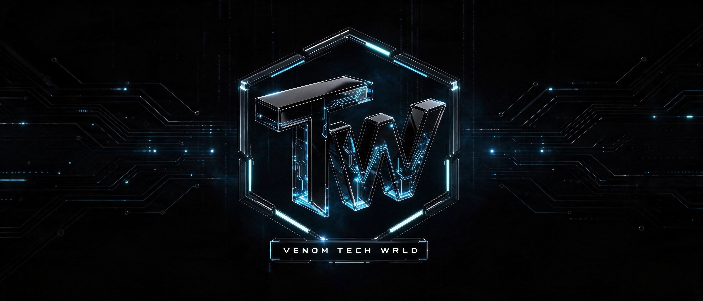
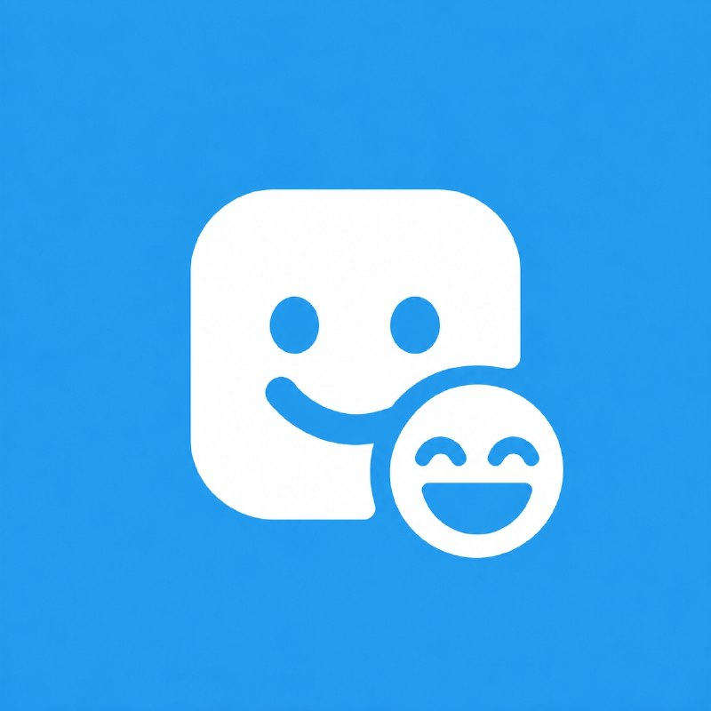
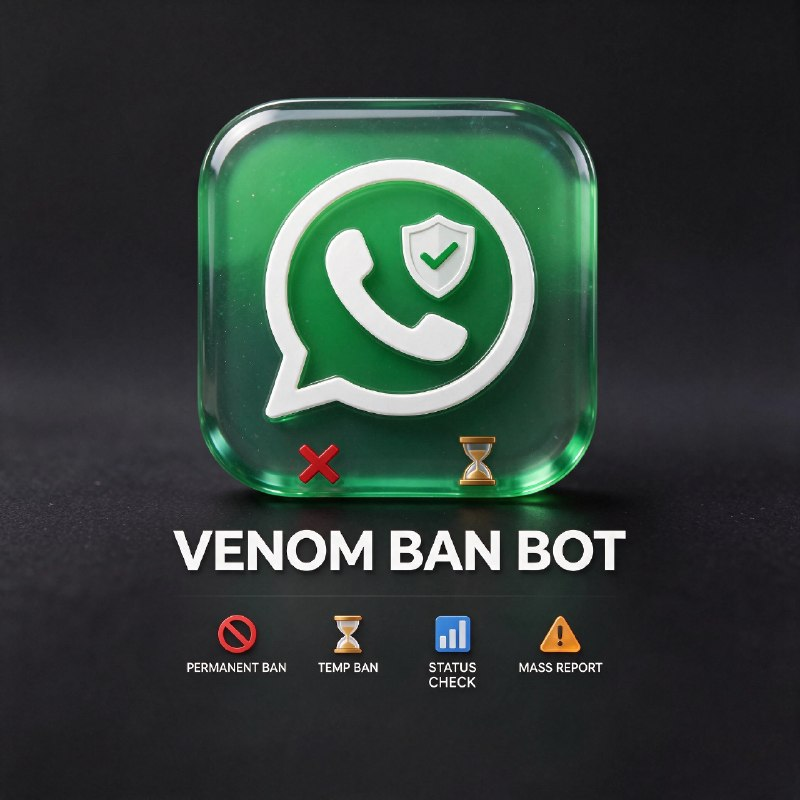
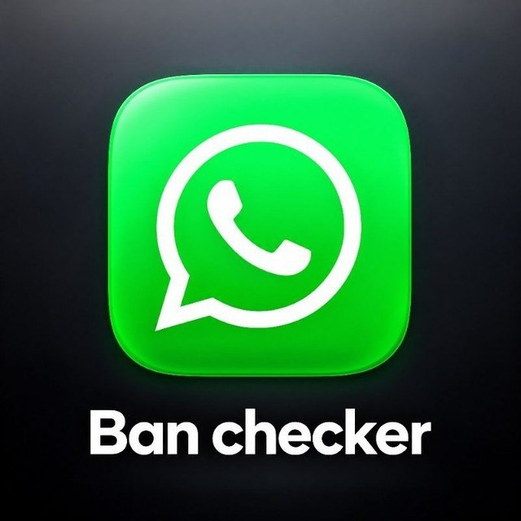

### Independent builder of Telegram bots, mini apps, and WhatsApp utilities

**I create and manage my projects, coding with JavaScript and Node.js.**

---

## Featured projects

<strong> CUSTOM EMOJI & STICKER PACK BOT</strong> 

Fetches Premium or custom emoji IDs, copies emoji details, reads IDs from emoji-pack links, and explores supported packs.

[Open the bot →](https://t.me/custom_emoji_id_robot) · [Channel post →](https://t.me/number_venom/2773)

---

<strong> PINTEREST SEARCHER</strong> 

An image-discovery experience inside Telegram, with image search, image-to-image exploration, recommendations, and community sharing features.

[Open the mini app →](https://t.me/Pinterest_Search_ai_Bot/pint) · [Channel post →](https://t.me/number_venom/3041)

---

<strong> VENOM BAN BOT</strong> 

A WhatsApp account-ban management bot. Its post lists permanent and temporary bans, unbanning, status checks, and referral and premium features.

[Open the bot →](https://t.me/venom_ban_bot?start=7213308911) · [Channel post →](https://t.me/number_venom/3053)

---

<strong> VENOM BAN CHECKER</strong> 

A WhatsApp account-status checker. Its post describes ban-status and appeal information, with private, group, guest, and inline access modes.

[Open the bot →](https://t.me/venom_mod_bot?start=bot) · [Mini app →](https://t.me/venom_mod_bot/check) · [Channel post →](https://t.me/number_venom/3062)

---

<strong> VENOM XMD</strong> 

A WhatsApp automation and group-management bot. Its post lists AI and automation, media features, and anti-link, anti-bot, anti-spam, anti-delete, and group-protection tools.

[Open the bot →](https://t.me/venom_xmd_bot?start=start) · [Channel post →](https://t.me/number_venom/3170)

---

## Built and maintained by me

I create and manage these projects, coding with **JavaScript** and **Node.js**. Follow the channels for updates and community news.

## Connect

**Email:** [venomtechwrld@gmail.com](mailto:venomtechwrld@gmail.com)  
**Telegram owner:** [@mr_darkvenom](https://t.me/mr_darkvenom)  
**Telegram community:** [@venom_domain1](https://t.me/venom_domain1)  
**Official Telegram channel:** [@number_venom](https://t.me/number_venom)  
**WhatsApp channel:** [Follow VENOM TECH WRLD](https://whatsapp.com/channel/0029Vb7vtQlDjiOXko7wwP0K)

*Building bold ideas into useful tools.*

